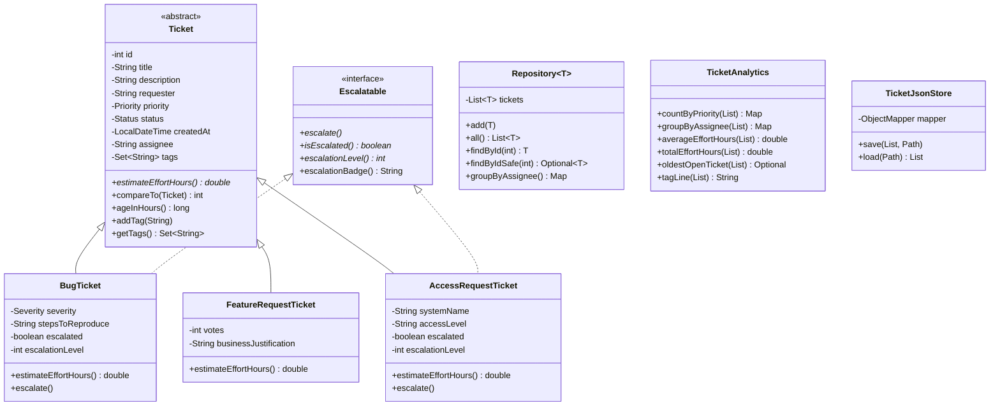

# 🎫 QueueDesk — IT Helpdesk Lifecycle & Triage Engine

[](https://www.oracle.com/java/)
[](https://maven.apache.org/)
[](https://junit.org/junit5/)
[](https://github.com/FasterXML/jackson)
  
> A core Java backend project modeling an enterprise IT ticketing, prioritization, and triage engine. Designed through **7 progressive builds (T1–T7)** where increasing requirements drove systematic class refactoring, object-oriented design, generic data structures, stream-based analytics, and polymorphic JSON persistence.

---

## 📖 Table of Contents
- [Project Overview](#-project-overview)
- [Architecture & Class Hierarchy](#-architecture--class-hierarchy)
- [The 7-Build Evolution Journey](#-the-7-build-evolution-journey)
  - [Build 1: QueueNumberSimulator](#build-1-queuenumbersimulator)
  - [Build 2 / T1: Domain Entity & Encapsulation](#build-2--t1-domain-entity--encapsulation)
  - [Build 3 / T3: Subclasses & Escalatable Capability](#build-3--t3-subclasses--escalatable-capability)
  - [Build 4 / T4: Generic Repository & Priority Queues](#build-4--t4-generic-repository--priority-queues)
  - [Build 5 / T5: Custom Exceptions, I/O & Reporting](#build-5--t5-custom-exceptions-io--reporting)
  - [Build 6 / T6: Functional Analytics with Java Streams](#build-6--t6-functional-analytics-with-java-streams)
  - [Build 7 / T7: Polymorphic JSON Persistence with Jackson](#build-7--t7-polymorphic-json-persistence-with-jackson)
- [Core Java & Backend Concepts Applied](#-core-java--backend-concepts-applied)
  - [OOP Principles](#1-oop-principles)
  - [Generics & Type Erasure](#2-generics--type-erasure)
  - [Collections & Heap Mechanics](#3-collections--heap-mechanics)
  - [Memory Management & Leak Prevention](#4-memory-management--leak-prevention)
  - [Stream API & Functional Pipelines](#5-stream-api--functional-pipelines)
  - [Exception Handling Architecture](#6-exception-handling-architecture)
- [Project Structure](#-project-structure)
- [Getting Started & Running Demos](#-getting-started--running-demos)
  - [Prerequisites](#prerequisites)
  - [Build & Run Tests](#build--run-tests)
  - [Running Individual Demos](#running-individual-demos)
- [Unit Testing Suite](#-unit-testing-suite)
- [Roadmap to Month 2](#-roadmap-to-month-2)

---

## 🎯 Project Overview

In an IT organization, employees raise issues across multiple functional categories:
* 🐛 **Software Bugs:** Require reproduction steps, severity grading, and variable resolution effort.
* 💡 **Feature Requests:** Driven by community votes and business justification.
* 🔐 **Access Requests:** Bound to security levels and target infrastructure.

**QueueDesk** provides the backend domain logic to:
1. Capture and validate polymorphic ticket entities safely.
2. Triage tickets through **dual priority queues** using natural ordering (Priority descending $\to$ Creation date ascending) and custom ordering (Assignee alphabetical $\to$ Priority).
3. Enforce **interface capabilities** (`Escalatable`) selectively on eligible ticket types.
4. Process tickets through **Java 8+ Stream pipelines** to extract real-time operational metrics.
5. Generate end-of-day summary reports using **`StringBuilder`** and **`EnumMap`**.
6. Migrate legacy pipe-delimited flat files into structured, polymorphic **JSON files** using Jackson.

---

## 🏗️ Architecture & Class Hierarchy



---

## 🔄 The 7-Build Evolution Journey

The project was constructed across 7 iterative builds, refactoring existing abstractions as requirements became more sophisticated:

### Build 1: `QueueNumberSimulator`
* **Focus:** Control flow, loops, primitive operators, `Scanner`.
* Simulates serving tickets sequentially with no arrays or collections.
* Flags every 5th customer as `VIP lane` and every 10th customer as `PRIORITY RECHECK`.
* **Design Rationale:** Evaluates `served % 10 == 0` *before* `served % 5 == 0` so that 10th tickets trigger priority checks rather than being masked as standard VIP calls.

### Build 2 / T1: Domain Entity & Encapsulation (`Ticket.java`)
* **Focus:** OOP foundations, access modifiers, constructors, static counters, enums.
* Implemented `Ticket` with `id`, `title`, `description`, `requester`, `Priority` (`LOW`, `MEDIUM`, `HIGH`, `CRITICAL`), and `Status` (`OPEN`, `IN_PROGRESS`, `RESOLVED`, `CLOSED`).
* **Auto-Incrementing IDs:** `private static int nextId = 1` maintained in class Metaspace.
* **Constructor Chaining:** Short constructor `this(title, requester)` delegates to full constructor with defaults via `this(...)`.
* **Input Validation:** Enforces non-blank titles using `isBlank()` (rejecting `"   "`, unlike `isEmpty()`).
* **Immutability:** `id`, `title`, `requester`, and `createdAt` are `final`.

### Build 3 / T3: Subclasses & Escalatable Capability
* **Refactoring:** Made `Ticket` an **abstract class**; declared `public abstract double estimateEffortHours()`.
* **Subclasses Created:**
  * `BugTicket`: Adds `Severity` enum and `stepsToReproduce`. Dynamic effort based on severity (`CRITICAL` = 10h, `HIGH` = 6h, `MEDIUM` = 3h, `LOW` = 1h).
  * `FeatureRequestTicket`: Adds `votes` ($\ge 0$) and `businessJustification`. Fixed 8h effort.
  * `AccessRequestTicket`: Adds `systemName` and `accessLevel`. Fixed 2h effort.
* **Interface Segregation:** Created `Escalatable` interface (`escalate()`, `isEscalated()`, `escalationLevel()`, and default method `escalationBadge()`). Only implemented by `BugTicket` and `AccessRequestTicket`.
* **Polymorphism:** `TriageBoard.printTriageBoard(List<Ticket>)` iterates the base type, dynamically dispatching `estimateEffortHours()` and checking `instanceof Escalatable` via Java 16+ pattern matching.

### Build 4 / T4: Generic Repository & Priority Queues
* **Refactoring:** Added `assignee` and `tags` (`Set<String>`) to `Ticket`.
* **Defensive Copying:** `getTags()` returns `Collections.unmodifiableSet(tags)`.
* **Natural Ordering (`Comparable<Ticket>`):** Sorted descending by priority (`CRITICAL` $\to$ `LOW`), tie-broken by `createdAt` ascending (older first).
* **Custom Comparators (`TicketComparators.java`):**
  * `BY_ASSIGNEE_THEN_PRIORITY`: Nulls first, assignee alphabetical, then priority descending.
  * `BY_STATUS_THEN_AGE`: Status alphabetical, then creation date.
* **Generic Repository (`Repository<T extends Ticket>`):** Typesafe container providing `add()`, `all()` (unmodifiable view), and `groupByAssignee()`.
* **Dual Triage Queues (`PriorityQ.java`):** Dual `PriorityQueue<Ticket>` backing natural order and comparator-based routing.

### Build 5 / T5: Custom Exceptions, I/O & Reporting
* **Exception Architecture:**
  * `InvalidTicketDataException extends Exception` (**Checked**): Thrown for corrupt file lines, invalid enums, or bad field counts.
  * `TicketNotFoundException extends RuntimeException` (**Unchecked**): Thrown by `Repository.findById(int id)` when an entity is missing.
* **File Ingestion (`TicketFileLoader.java`):** Reads pipe-delimited `tickets.txt` via `BufferedReader` inside a `try-with-resources` block.
* **Report Generation (`TicketReportGenerator.java`):** Uses `EnumMap` and `StringBuilder` to assemble an end-of-day summary file (`ticket_report.txt`) listing counts by status, priority, and overdue critical tickets ($> 24\text{h}$).

### Build 6 / T6: Functional Analytics with Java Streams (`TicketAnalytics.java`)
* Replaced imperative loops with functional Stream pipelines:
  * `countByPriority()` $\to$ `Collectors.groupingBy(Ticket::getPriority, Collectors.counting())`
  * `groupByAssignee()` $\to$ `Collectors.groupingBy(Ticket::getAssignee)`
  * `averageEffortHours()` $\to$ `.mapToDouble(...).average().orElse(0.0)`
  * `totalEffortHours()` $\to$ `.map(...).reduce(0.0, Double::sum, Double::sum)`
  * `oldestOpenTicket()` $\to$ `.filter(Status.OPEN).min(Comparator.comparing(createdAt))`
  * `tagLine()` $\to$ `.flatMap(tags.stream()).distinct().sorted().collect(joining(", "))`
* **Safe Repository Lookup:** Added `findByIdSafe(int id)` returning `Optional<T>`.

### Build 7 / T7: Polymorphic JSON Persistence with Jackson (`TicketJsonStore.java`)
* Persists ticket collections into structured `tickets.json` and reconstructs them into their concrete subclasses.
* **Polymorphic Discriminator:** Configured `@JsonTypeInfo(use = NAME, include = AS_PROPERTY, property = "type")` and `@JsonSubTypes` on `Ticket.java`.
* **Immutable Construction:** Annotated subclass constructors with `@JsonCreator` and `@JsonProperty`.
* **ObjectMapper Configuration:**
  * Registered `JavaTimeModule` for `java.time.LocalDateTime`.
  * Disabled `SerializationFeature.WRITE_DATES_AS_TIMESTAMPS` (outputs readable ISO-8601 strings).
  * Enabled `SerializationFeature.INDENT_OUTPUT` (pretty-printing).
* **Overcoming Type Erasure:** Deserializes via `new TypeReference<List<Ticket>>() {}` to preserve generic type tokens.

---

## 💡 Core Java & Backend Concepts Applied

### 1. OOP Principles
* **Encapsulation:** Private fields, immutable identifiers, read-only defensive views via `Collections.unmodifiableList()` and `unmodifiableSet()`.
* **Abstraction:** `Ticket` hides concrete categorization while guaranteeing common contract methods (`estimateEffortHours()`).
* **Inheritance:** Code reuse through base constructors (`super(...)`) while allowing specialized subclass attributes.
* **Polymorphism:** Dynamic vtable method dispatch in `TriageBoard` and Stream aggregations.
* **Interface Segregation:** `Escalatable` isolates escalation capabilities to only applicable ticket types.

### 2. Generics & Type Erasure
* **Bounded Type Parameters:** `Repository<T extends Ticket>` guarantees compile-time type safety.
* **Type Erasure:** At runtime, the JVM strips generic parameters (treating `List<Ticket>` as raw `List`). `TypeReference` captures anonymous subclass bytecode metadata to allow Jackson to deserialize lists safely.

### 3. Collections & Heap Mechanics
* **`ArrayList`:** Dynamic array allocation offering $O(1)$ indexed reads.
* **`HashSet`:** $O(1)$ lookups backed by hash buckets to prevent duplicate tags.
* **`PriorityQueue`:** Array-backed binary min-heap offering $O(\log n)$ insertion (`offer()`) and extraction (`poll()`), and $O(1)$ `peek()`.
* **`EnumMap`:** High-performance map backed by an array indexed by enum `ordinal()`, eliminating hashing overhead.

### 4. Memory Management & Leak Prevention
* **Stack vs Heap:** Stack stores primitive method variables and reference pointers; Heap stores allocated instances.
* **Logical Memory Leaks in Java:** Garbage collection reclaims unreferenced objects, but **cannot clean reachable objects that are logically dead**.
* **QueueDesk Defenses:**
  * Dual-queue memory awareness: Preventing reference retention if only one queue is drained.
  * File descriptor protection: Using `try-with-resources` to ensure OS handles are released.
  * Architectural readiness: Recognizing the need for eviction policies and database pagination in long-running services.

### 5. Stream API & Functional Pipelines
* **Lazy vs Eager:** Intermediate operations (`filter`, `map`, `flatMap`) construct an unexecuted pipeline until triggered by a terminal operation (`collect`, `reduce`, `average`).
* **`map` vs `flatMap`:** `map` transforms $A \to B$; `flatMap` transforms $A \to \text{Stream}\langle B\rangle$ and flattens nested streams into a single sequence (e.g., merging tag sets).

### 6. Exception Handling Architecture
* **Checked (`InvalidTicketDataException`):** For external, recoverable failures (bad file input).
* **Unchecked (`TicketNotFoundException`):** For logic defects or missing entities.
* **Exception Chaining:** `InvalidTicketDataException(msg, cause)` preserves underlying Jackson `IOException` stack traces for debugging.

---

## 📁 Project Structure

```
queuedesk/
├── pom.xml                                     # Maven build definition & dependencies
├── tickets.txt                                 # Legacy pipe-delimited flat file
├── tickets.json                                # Jackson-managed polymorphic JSON store
├── ticket_report.txt                           # Generated end-of-day summary report
├── README.md                                   # Project documentation
├── src/
│   ├── main/
│   │   └── java/
│   │       └── com/
│   │           └── queuedesk/
│   │               ├── Priority.java                   # Enum: LOW, MEDIUM, HIGH, CRITICAL
│   │               ├── Status.java                     # Enum: OPEN, IN_PROGRESS, RESOLVED, CLOSED
│   │               ├── Severity.java                   # Enum: LOW, MEDIUM, HIGH, CRITICAL
│   │               ├── Ticket.java                     # Abstract root entity (Comparable)
│   │               ├── BugTicket.java                  # Subclass: Severity, steps, Escalatable
│   │               ├── FeatureRequestTicket.java       # Subclass: votes, business justification
│   │               ├── AccessRequestTicket.java        # Subclass: systemName, accessLevel, Escalatable
│   │               ├── Escalatable.java                # Capability interface with default badge
│   │               ├── TriageBoard.java                # Polymorphic board printer
│   │               ├── TicketComparators.java          # Custom Comparator rules
│   │               ├── Repository.java                 # Generic container <T extends Ticket>
│   │               ├── PriorityQ.java                  # Dual PriorityQueue manager
│   │               ├── TicketUtils.java                # Generic utility methods (oldest)
│   │               ├── InvalidTicketDataException.java # Custom checked exception
│   │               ├── TicketNotFoundException.java    # Custom unchecked exception
│   │               ├── TicketFileLoader.java           # Pipe-delimited flat file parser
│   │               ├── TicketReportGenerator.java      # End-of-day summary generator
│   │               ├── TicketAnalytics.java            # Java 8+ Stream analytics engine
│   │               ├── TicketJsonStore.java            # Jackson JSON serializer/deserializer
│   │               ├── QueueNumberSimulator.java       # Build 1 entry point
│   │               ├── T1Demo.java                     # Build 2 validation demo
│   │               ├── T2Demo.java                     # Build 3 abstract entity demo
│   │               ├── T3Demo.java                     # Subclass effort demo
│   │               ├── T3Demo1.java                    # Polymorphic triage demo
│   │               ├── T4Demo.java                     # Repository & PriorityQueue demo
│   │               ├── T5Demo.java                     # Exception & file reporting demo
│   │               ├── T6Demo.java                     # Stream analytics demo
│   │               └── Main.java                       # Build 7 migration demo (TXT -> JSON)
│   └── test/
│       └── java/
│           └── com/
│               └── queuedesk/
│                   └── TicketTest.java                 # 14-test JUnit 5 test suite
```

---

## 🚀 Getting Started & Running Demos

### Prerequisites
* **Java Development Kit (JDK):** Version 21 or higher.
* **Apache Maven:** Version 3.8+ installed and configured on your PATH.

### Build & Run Tests
Compile the codebase and run all automated unit tests:
```powershell
mvn clean test
```

### Running Individual Demos

#### 1. Stream Analytics Demo (T6)
Demonstrates grouping by priority, grouping by assignee, calculating effort averages/totals, finding the oldest open ticket, and formatting tag lines:
```powershell
mvn compile exec:java -Dexec.mainClass="com.queuedesk.T6Demo"
```

#### 2. Dual Priority Queue & Repository Demo (T4)
Demonstrates natural priority ordering, custom assignee sorting, and unmodifiable defensive views:
```powershell
mvn compile exec:java -Dexec.mainClass="com.queuedesk.T4Demo"
```

#### 3. File I/O & Report Generation Demo (T5)
Loads tickets from `tickets.txt` and writes `ticket_report.txt`:
```powershell
mvn compile exec:java -Dexec.mainClass="com.queuedesk.T5Demo"
```

#### 4. Complete Migration & JSON Persistence Demo (Main)
Reads legacy pipe-delimited data, writes to `tickets.json`, and deserializes concrete subclasses back into memory:
```powershell
mvn compile exec:java -Dexec.mainClass="com.queuedesk.Main"
```

---

## 🧪 Unit Testing Suite

The project includes **14 JUnit 5 unit tests** in [`TicketTest.java`](src/test/java/com/queuedesk/TicketTest.java) adhering to the **FIRST** principles (Fast, Isolated, Repeatable, Self-Verifying, Timely):

| # | Test Method | Target Component | Verifies |
|---|---|---|---|
| 1 | `ticketShouldStoreCorrectDetails` | `BugTicket` | Field assignment and inheritance integrity |
| 2 | `ticketShouldRejectBlankTitle` | `Ticket` constructor | `IllegalArgumentException` thrown on `"   "` |
| 3 | `ticketPriorityCanBeUpdated` | `Ticket.setPriority` | State mutability of lifecycle fields |
| 4 | `ticketsShouldHaveDifferentIds` | Static ID Counter | Monotonically unique auto-incrementing IDs |
| 5 | `repositoryShouldAddTickets` | `Repository.add` | Storage insertion into generic list |
| 6 | `repositoryShouldFindTicketById` | `Repository.findById` | Retrieval of existing entities |
| 7 | `repositoryShouldThrowWhenTicketNotFound` | `Repository.findById` | Unchecked `TicketNotFoundException` on missing ID |
| 8 | `repositoryAllShouldBeUnmodifiable` | `Repository.all` | `UnsupportedOperationException` on external mutation |
| 9 | `analyticsShouldCountTicketsByPriority` | `TicketAnalytics` | Stream `Collectors.groupingBy` & counting |
| 10 | `analyticsShouldCalculateAverageEffort` | `TicketAnalytics` | `mapToDouble().average()` calculation |
| 11 | `analyticsShouldCalculateTotalEffort` | `TicketAnalytics` | `map().reduce(0.0, Double::sum, ...)` calculation |
| 12 | `analyticsShouldFindOldestOpenTicket` | `TicketAnalytics` | Stream filtering with `min(Comparator)` |
| 13 | `ticketsShouldSortByPriorityDescending` | `Comparable<Ticket>` | Natural ordering (`CRITICAL` before `LOW`) |
| 14 | `comparatorShouldSortTicketsByAssignee` | `TicketComparators` | Null-safe alphabetical assignee sorting |

---

