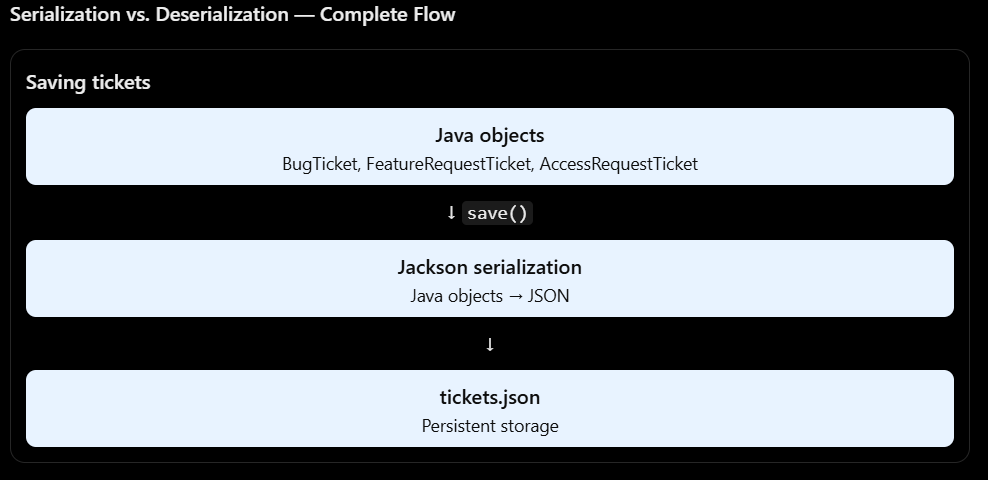
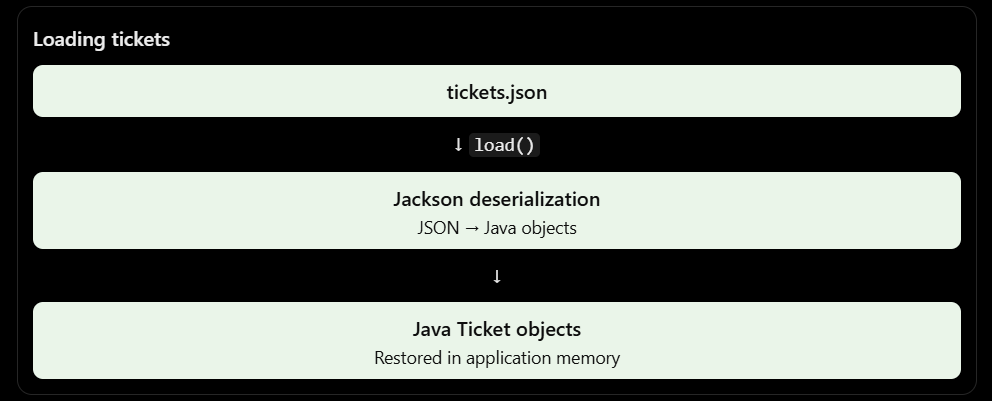

Imagine u run queuedesk and create 3 tickets: A bug, a featureRequest, an accessRequest ticket
Currently, these tickets are java objects stored in our application's memory.
Ticket ticket = new bugTicket(..);
But there is a problem:
What will happen when your application stops running?
Objects stored in memory disappears when the prgram terminates.So, we may need to store ticket info outside the application and load it again later.

Before T7 
Java ticket objects -> Application stops -> objects disappear 

After T7 
Java Ticket Objects -> Jackson converts objects into json -> tickets.json file -> data remains saved 

When the application starts again, we can read the json file and reconstruct the java ticket objects.

JSON - JSON is simply a format for representing data.
JSON is a structured data format that represents information using key-value pairs and arrays. Unlike a pipe-delimited file, JSON makes each field identifiable by its name.
101|Login page crashes|HIGH|OPEN
{
  "id": 101,
  "title": "Login page crashes",
  "priority": "HIGH",
  "status": "OPEN"
}

Jackson? Java doesn't automatically know how to convert everyobject into json.
Jackson is a java library that performs this conversion.
2 imp operations: 
1.Serializaion : Java Object -> JSON ; saves ticket information
2.Deserialization : JSON -> Java Object ; Load ticket information 

for queuedesk, 
save() performs serialization & load() performs deserialization.

What is a Java Annotation?
An annotation is metadata added to Java code using the @ symbol.

It provides additional information about a class, method, field, or other program element to the compiler, tools, or libraries.

In simple terms, think of an annotation as a label that tells Java or a library something about the code.
Example: @Override
We have already used this annotation in our QueueDesk project:
@Override
public String toString() {
    return "Ticket: " + title;
}

- toString() is a method inherited from Java's Object class.
- We are providing our own implementation of that method.
- @Override tells the compiler that we intend to override an existing method.
- If we accidentally write the method name incorrectly, Java can detect the mistake.

Annotation - Purpose
@Override	- Indicates that a method overrides an inherited method.
@Deprecated - Indicates that a feature is outdated or discouraged.
@Test -	Marks a method as a test case in JUnit.
@JsonTypeInfo	- Tells Jackson how to identify object types in JSON.
@JsonSubTypes	- Maps JSON type names to their corresponding Java subclasses.

Important: Annotations provide metadata. They don't automatically write or execute the business logic for us. Libraries such as Jackson inspect their annotations and use that information when processing objects.

Why do we need Jackson annotations in QueueDesk?
Recall that our project has:
public abstract class Ticket

And three subclasses:
BugTicket
FeatureRequestTicket
AccessRequestTicket

Suppose we save a BugTicket into JSON:
{
  "id": 101,
  "title": "Login page crashes",
  "priority": "HIGH"
}

When Jackson reads this JSON, how will it know whether to create a BugTicket, FeatureRequestTicket, or AccessRequestTicket?

It cannot reliably identify the correct subclass just from these fields.

Solution: We add a type property to the JSON.
{
  "type": "bug",
  "id": 101,
  "title": "Login page crashes",
  "priority": "HIGH"
}

Now Jackson knows that this JSON represents a BugTicket.

We use two annotations to achieve this.
1 @JsonTypeInfo
It tells Jackson where and how to identify the concrete class type when processing JSON.
2 @JsonSubTypes
It tells Jackson which Java subclass corresponds to each JSON type name.

Our mapping:
JSON type |	Java class
"bug" |	BugTicket
"feature" |	FeatureRequestTicket
"access" |	AccessRequestTicket

## How do @JsonTypeInfo and @JsonSubTypes work together?
Both annotations are added above the abstract Ticket class.

- @JsonTypeInfo = tells Jackson where to find the type information in JSON.
- @JsonSubTypes = tells Jackson which Java subclass corresponds to each type name.
Syntax
@JsonTypeInfo(
    use = JsonTypeInfo.Id.NAME,
    include = JsonTypeInfo.As.PROPERTY,
    property = "type"
)
@JsonSubTypes({
    @JsonSubTypes.Type(value = BugTicket.class, name = "bug"),
    @JsonSubTypes.Type(value = FeatureRequestTicket.class, name = "feature"),
    @JsonSubTypes.Type(value = AccessRequestTicket.class, name = "access")
})
public abstract class Ticket implements Comparable<Ticket> 

Explanation
1. @JsonTypeInfo
@JsonTypeInfo(
    use = JsonTypeInfo.Id.NAME,
    include = JsonTypeInfo.As.PROPERTY,
    property = "type"
)

- use = JsonTypeInfo.Id.NAME — identifies subclasses using names such as "bug" or "feature".
- include = JsonTypeInfo.As.PROPERTY — stores the type information as a JSON property.
- property = "type" — names that JSON property "type".
2. @JsonSubTypes
@JsonSubTypes({
    @JsonSubTypes.Type(value = BugTicket.class, name = "bug"),
    @JsonSubTypes.Type(value = FeatureRequestTicket.class, name = "feature"),
    @JsonSubTypes.Type(value = AccessRequestTicket.class, name = "access")
})

This defines the mapping between JSON type names and Java classes.
JSON property	Java class Jackson creates
"type": "bug"	BugTicket
"type": "feature"	FeatureRequestTicket
"type": "access"	AccessRequestTicket

How they work together
When Jackson deserializes JSON:
1. @JsonTypeInfo tells Jackson to look for the "type" property.
2. Jackson reads its value, such as "bug".
3. @JsonSubTypes maps "bug" to BugTicket.class.
4. Jackson creates the corresponding BugTicket object.
In short: @JsonTypeInfo tells Jackson how to identify the type, while @JsonSubTypes tells it which class that type represents.

ObjectMapper in Jackson
1. What is ObjectMapper?
ObjectMapper is the main class provided by the Jackson library that performs the conversion between Java objects and JSON.

In simple terms:
- Java object → JSON: Serialization
- JSON → Java object: Deserialization
We create an ObjectMapper object to perform these operations.
ObjectMapper mapper = new ObjectMapper();

Here:
- ObjectMapper is the class provided by Jackson.
- mapper is the variable holding the ObjectMapper object.
- new ObjectMapper() creates a new ObjectMapper instance.
Why do we configure ObjectMapper?
QueueDesk uses LocalDateTime for ticket creation timestamps and needs readable JSON output.
ObjectMapper mapper = new ObjectMapper()
        .registerModule(new JavaTimeModule())
        .disable(SerializationFeature.WRITE_DATES_AS_TIMESTAMPS)
        .enable(SerializationFeature.INDENT_OUTPUT);

Code	Purpose
new ObjectMapper()	Creates the Jackson mapper
registerModule(new JavaTimeModule())	Enables support for Java date/time types like LocalDateTime
disable(WRITE_DATES_AS_TIMESTAMPS)	Writes dates as readable text instead of timestamps
enable(INDENT_OUTPUT)	Formats JSON with indentation for readability

We configure the mapper once and reuse it for saving and loading tickets.

2. Complete Java → JSON → Java flow
QueueDesk T7: Complete Flow
Step 1: Java objects in memory

BugTicket, FeatureRequestTicket, AccessRequestTicket

↓ save(tickets, file)
Step 2: ObjectMapper

Serialization: Java objects → JSON

↓
Step 3: tickets.json

Ticket data stored persistently on disk

Application restarts

Step 4: ObjectMapper reads JSON

Deserialization: JSON → Java objects

↓ load(file)
Step 5: Java objects restored

Correct subclasses are reconstructed

Step 1: Create Java objects
Imagine we create different ticket types:
List<Ticket> tickets = new ArrayList<>();

tickets.add(new BugTicket(...));
tickets.add(new FeatureRequestTicket(...));
tickets.add(new AccessRequestTicket(...));

These objects currently exist in application memory.
Step 2: Serialize the objects
mapper.writeValue(file.toFile(), tickets);

This tells Jackson:
Convert the Java ticket objects into JSON and write the result to the specified file.

The method writeValue() performs serialization.

Example output:
[
  {
    "type": "bug",
    "id": 101,
    "title": "Login page crashes",
    "priority": "HIGH"
  },
  {
    "type": "feature",
    "id": 102,
    "title": "Add dark mode",
    "priority": "MEDIUM"
  },
  {
    "type": "access",
    "id": 103,
    "title": "Request database access",
    "priority": "LOW"
  }
]

The exact JSON fields depend on the fields and getters in our ticket classes.

Notice that the JSON includes "type" so Jackson can identify each subclass later.
Step 3: Store the JSON
The JSON is written into:
tickets.json

Unlike Java objects in RAM, this file remains available after the application terminates.
Step 4: Deserialize the JSON
When QueueDesk starts again:
List<Ticket> tickets = mapper.readValue(
        file.toFile(),
        new TypeReference<List<Ticket>>() {}
);

This tells Jackson:
Read the JSON file and reconstruct a list of Java Ticket objects.

Jackson uses the "type" property and the annotations on Ticket to determine which subclass each JSON object represents.

For example:
{
  "type": "bug",
  "id": 101,
  "title": "Login page crashes"
}

Jackson identifies "bug" and reconstructs a BugTicket.

3. What is TicketJsonStore?
Instead of writing Jackson code throughout the application, we create one class responsible for storing and loading tickets.
public class TicketJsonStore {

    private final ObjectMapper mapper;

    public TicketJsonStore() {
        this.mapper = new ObjectMapper()
                .registerModule(new JavaTimeModule())
                .disable(SerializationFeature.WRITE_DATES_AS_TIMESTAMPS)
                .enable(SerializationFeature.INDENT_OUTPUT);
    }

    public void save(List<Ticket> tickets, Path file)
            throws InvalidTicketDataException {

        try {
            mapper.writeValue(file.toFile(), tickets);
        } catch (IOException e) {
            throw new InvalidTicketDataException(
                    "Failed to save tickets", e);
        }
    }

    public List<Ticket> load(Path file)
            throws InvalidTicketDataException {

        try {
            return mapper.readValue(
                    file.toFile(),
                    new TypeReference<List<Ticket>>() {}
            );
        } catch (IOException e) {
            throw new InvalidTicketDataException(
                    "Failed to load tickets", e);
        }
    }
}

This is an illustrative version of the store; we should verify the constructor of InvalidTicketDataException and Jackson compatibility with the existing ticket subclasses before using it directly.
Why create a separate store class?
- Keeps JSON-related logic in one place.
- Prevents other classes from needing to know about Jackson.
- Makes saving and loading easier to reuse.
- If we change the storage implementation later, the rest of the application can remain mostly unchanged.

4. Important methods to remember
Method |	Meaning
new ObjectMapper() |	Creates a mapper
writeValue() |	Serializes Java objects into JSON
readValue()	| Deserializes JSON into Java objects
registerModule()	| Adds support for extra data types
TypeReference<List<Ticket>> |	Tells Jackson the expected generic collection type

ObjectMapper is Jackson’s main API for serialization and deserialization. In QueueDesk, we configure it with JavaTimeModule to support LocalDateTime and use writeValue to save tickets as JSON. On application startup, readValue loads the JSON and reconstructs a List of Ticket objects. Since Ticket is abstract and has multiple subclasses, we use JsonTypeInfo and JsonSubTypes to preserve the correct ticket type.